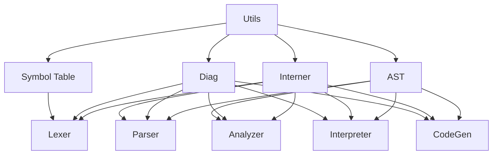

# Librerías del Proyecto Quimera - Documentación Completa

> **Componentes de Soporte**: Librerías base y utilidades del compilador Quimera  
> **Estado**: ✅ **COMPLETAMENTE IMPLEMENTADAS**

---

## 📋 Índice

1. [Resumen General](#resumen-general)
2. [Interner - Sistema de Strings Internadas](#interner---sistema-de-strings-internadas)
3. [Diag - Sistema de Diagnósticos](#diag---sistema-de-diagnósticos)
4. [Utils - Utilidades Generales](#utils---utilidades-generales)
5. [Symbol Table - Tabla de Símbolos](#symbol-table---tabla-de-símbolos)
6. [AST - Árbol de Sintaxis Abstracta](#ast---árbol-de-sintaxis-abstracta)
7. [CodeGen - Generación de Código](#codegen---generación-de-código)
8. [Integración entre Librerías](#integración-entre-librerías)

---

## 🎯 Resumen General

Las **librerías de soporte** de Quimera proporcionan funcionalidad base reutilizable para todos los componentes del compilador. Implementan servicios esenciales como gestión de memoria, manejo de strings, diagnósticos, y estructuras de datos especializadas.

### Librerías Implementadas
- ✅ **Interner**: Optimización de strings con interning
- ✅ **Diag**: Sistema unificado de diagnósticos JSON
- ✅ **Utils**: Utilidades generales y estructuras básicas
- ✅ **Symbol Table**: Tablas de símbolos predefinidos
- ✅ **AST**: Gestión del árbol de sintaxis abstracta
- ✅ **CodeGen**: Base para generación de código (futuro)

---

## 🧵 Interner - Sistema de Strings Internadas

> **Archivo**: `src/interner/interner.c` + `include/interner.h`  
> **Propósito**: Optimización de memoria y comparaciones de strings

### Concepto de String Interning

El **string interning** es una técnica de optimización que almacena solo una copia de cada string único en memoria, permitiendo comparaciones O(1) mediante comparación de punteros en lugar de `strcmp()`.

### Estructura Principal

```c
typedef struct {
    char **strings;       // Array de strings internados
    size_t count;         // Número de strings actuales
    size_t capacity;      // Capacidad total
    size_t total_chars;   // Total de caracteres almacenados
} Interner;

// Símbolos predefinidos del lenguaje
typedef struct {
    // Tipos de datos
    const char *T_Integer, *T_Float, *T_String, *T_Boolean, *T_Char, *T_List;
    
    // Palabras clave
    const char *K_If, *K_ElseIf, *K_Else, *K_For, *K_While;
    const char *K_Return, *K_End, *K_Print, *K_Read, *K_Not;
    const char *K_True, *K_False, *K_Null;
    
    // Operadores textuales
    const char *O_And, *O_Or;
    
    // Delimitadores comunes
    const char *D_LeftParen, *D_RightParen, *D_LeftBrace, *D_RightBrace;
    const char *D_LeftBracket, *D_RightBracket, *D_Comma, *D_Semicolon, *D_Colon;
} Interned;
```

### API Principal

```c
// Gestión del interner
void interner_init(Interner *interner);
void interner_destroy(Interner *interner);

// Internar strings
const char *interner_intern_cstr(Interner *interner, const char *str);
const char *interner_intern_len(Interner *interner, const char *str, size_t len);

// Inicializar símbolos predefinidos
void interner_init_symbols(Interner *interner, Interned *symbols);

// Verificar si string ya está internado
bool interner_contains(const Interner *interner, const char *str);
```

### Algoritmo de Interning

```c
const char *interner_intern_cstr(Interner *interner, const char *str) {
    if (!str) return NULL;
    
    // Buscar si ya existe
    for (size_t i = 0; i < interner->count; i++) {
        if (strcmp(interner->strings[i], str) == 0) {
            return interner->strings[i]; // Retornar referencia existente
        }
    }
    
    // No existe, crear nueva copia
    if (interner->count >= interner->capacity) {
        interner_resize(interner);
    }
    
    // Duplicar string
    size_t len = strlen(str);
    char *new_str = malloc(len + 1);
    strcpy(new_str, str);
    
    interner->strings[interner->count] = new_str;
    interner->count++;
    interner->total_chars += len;
    
    return new_str;
}
```

### Ventajas del Sistema

```c
// ANTES (sin interner):
if (strcmp(token.lexeme, "Integer") == 0) { ... } // O(n) comparación

// DESPUÉS (con interner):
if (token.lexeme == symbols.T_Integer) { ... }    // O(1) comparación
```

### Uso en el Compilador

```c
// Inicialización en main.c
Interner interner;
Interned symbols;
interner_init(&interner);
interner_init_symbols(&interner, &symbols);

// Uso en lexer
const char *lexeme = interner_intern_cstr(&interner, raw_token_text);

// Uso en parser
if (token->lexeme == symbols.K_If) {
    // Es palabra clave 'If'
}

// Uso en analyzer
Symbol *symbol = symbol_lookup(analyzer, identifier_name); // Búsqueda eficiente
```

---

## 🩺 Diag - Sistema de Diagnósticos

> **Archivo**: `src/utils/diag.c` + `include/diag.h`  
> **Propósito**: Sistema unificado de diagnósticos con salida JSON estructurada

### Filosofía del Sistema

El sistema de diagnósticos proporciona **reportes consistentes** de errores, warnings y información desde todas las fases del compilador, con formato JSON estructurado para fácil integración con IDEs.

### Estructura de Diagnósticos

```c
typedef enum {
    STAGE_LEXICAL,    // Fase léxica
    STAGE_PARSER,     // Fase sintáctica
    STAGE_SEMANTIC,   // Fase semántica
    STAGE_RUNTIME,    // Tiempo de ejecución
    STAGE_SYSTEM      // Errores del sistema
} DiagStage;

typedef enum {
    SEVERITY_ERROR,   // Error crítico
    SEVERITY_WARNING, // Advertencia
    SEVERITY_INFO     // Información
} DiagSeverity;

typedef struct {
    int line;         // Línea del error
    int column;       // Columna del error
    int length;       // Longitud del token problemático
    const char *lexeme; // Texto del token (opcional)
} DiagLocation;
```

### API Principal

```c
// Crear ubicaciones
DiagLocation diag_location_create(int line, int column, int length, const char *lexeme);
DiagLocation diag_location_simple(int line, int column);

// Reportar diagnósticos
void diag_error(DiagStage stage, int code, DiagLocation loc, const char *message);
void diag_warning(DiagStage stage, int code, DiagLocation loc, const char *message);
void diag_info(DiagStage stage, int code, DiagLocation loc, const char *message);

// Control de salida
void diag_set_output_file(FILE *file);
void diag_set_json_output(bool enabled);
```

### Códigos de Error por Fase

```c
// Códigos de error organizados por fase
#define LEXER_ERROR_BASE       1000
#define PARSER_ERROR_BASE      2000
#define SEMANTIC_ERROR_BASE    3000
#define RUNTIME_ERROR_BASE     4000
#define SYSTEM_ERROR_BASE      5000

// Ejemplos específicos:
#define LEXER_ERROR_INVALID_CHAR        1001
#define LEXER_ERROR_UNTERMINATED_STRING 1002

#define PARSER_ERROR_UNEXPECTED_TOKEN   2002
#define PARSER_ERROR_TOK_ERROR         2003
#define PARSER_ERROR_MISSING_SEMICOLON 2004

#define SEMANTIC_ERROR_UNKNOWN_TYPE     3001
#define SEMANTIC_ERROR_TYPE_MISMATCH    3003
#define SEMANTIC_ERROR_UNDECLARED_ID    3008

#define RUNTIME_ERROR_DIVISION_BY_ZERO  4001
#define RUNTIME_ERROR_INDEX_OUT_OF_RANGE 4002

#define SYSTEM_ERROR_OUT_OF_MEMORY      5001
#define SYSTEM_ERROR_FILE_NOT_FOUND     5002
```

### Formato JSON de Salida

```json
{
  "type": "diagnostic",
  "stage": "semantic",
  "severity": "error",
  "code": 3008,
  "line": 15,
  "column": 8,
  "length": 5,
  "lexeme": "myVar",
  "message": "Identificador no declarado: 'myVar'"
}
```

### Implementación de Reporte

```c
void diag_error(DiagStage stage, int code, DiagLocation loc, const char *message) {
    const char *stage_name = get_stage_name(stage);
    
    if (json_output_enabled) {
        fprintf(output_file, 
            "{"
            "\"type\":\"diagnostic\","
            "\"stage\":\"%s\","
            "\"severity\":\"error\","
            "\"code\":%d,"
            "\"line\":%d,"
            "\"column\":%d,"
            "\"length\":%d,"
            "\"lexeme\":\"%s\","
            "\"message\":\"%s\""
            "}\n",
            stage_name, code, loc.line, loc.column, loc.length,
            loc.lexeme ? loc.lexeme : "", message
        );
    } else {
        fprintf(output_file, "Error[%s:%d]: %s (línea %d, columna %d)\n",
                stage_name, code, message, loc.line, loc.column);
    }
    
    fflush(output_file);
}
```

### Uso en las Fases

```c
// En lexer.c
if (invalid_character) {
    DiagLocation loc = diag_location_create(lexer->line, lexer->column, 1, &invalid_char);
    diag_error(STAGE_LEXICAL, LEXER_ERROR_INVALID_CHAR, loc, 
              "Carácter inválido en código fuente");
}

// En parser.c
if (!expect_token(TOK_SEMICOLON)) {
    DiagLocation loc = diag_location_create(token->line, token->column, token->length, token->lexeme);
    diag_error(STAGE_PARSER, PARSER_ERROR_MISSING_SEMICOLON, loc,
              "Se esperaba punto y coma");
}

// En analyzer.c
if (type_mismatch) {
    diag_error(STAGE_SEMANTIC, SEMANTIC_ERROR_TYPE_MISMATCH, expr_span,
              "Tipos incompatibles en operación");
}
```

---

## 🔧 Utils - Utilidades Generales

> **Archivo**: `src/utils/utils.c` + `include/utils.h`  
> **Propósito**: Estructuras de datos básicas y utilidades comunes

### Estructuras de Datos

#### TokenList - Lista Dinámica de Tokens

```c
typedef struct {
    Token *tokens;       // Array dinámico de tokens
    size_t count;        // Número de tokens actuales
    size_t capacity;     // Capacidad total
} TokenList;

// API de TokenList
void token_list_init(TokenList *list);
void token_list_push(TokenList *list, Token token);
void token_list_destroy(TokenList *list);
Token *token_list_at(TokenList *list, size_t index);
```

#### SrcSpan - Información de Posición

```c
typedef struct {
    int line_start;      // Línea de inicio
    int col_start;       // Columna de inicio
    int line_end;        // Línea de fin
    int col_end;         // Columna de fin
} SrcSpan;

// Utilidades de SrcSpan
SrcSpan span_create(int line_start, int col_start, int line_end, int col_end);
SrcSpan span_from_token(const Token *token);
SrcSpan span_merge(SrcSpan a, SrcSpan b);
bool span_contains(SrcSpan span, int line, int col);
```

### Utilidades de Memoria

```c
// Redimensionamiento dinámico seguro
void *safe_realloc(void *ptr, size_t old_size, size_t new_size);

// Duplicación de strings con verificación
char *safe_strdup(const char *str);

// Liberación segura con null-check
void safe_free(void **ptr);
```

### Utilidades de Archivos

```c
// Lectura completa de archivo
char *read_entire_file(const char *filename, size_t *out_size);

// Verificación de existencia
bool file_exists(const char *filename);

// Obtener directorio base
char *get_directory(const char *filepath);
```

### Utilidades de Strings

```c
// Trim de espacios en blanco
char *str_trim(char *str);

// Verificación de prefijo/sufijo
bool str_starts_with(const char *str, const char *prefix);
bool str_ends_with(const char *str, const char *suffix);

// Reemplazo de caracteres
char *str_replace_char(char *str, char old_char, char new_char);
```

---

## 📚 Symbol Table - Tabla de Símbolos

> **Archivo**: `src/tables/symbol_table.c` + `include/symbol_table.h`  
> **Propósito**: Definición de símbolos predefinidos del lenguaje

### Tablas de Símbolos Predefinidos

```c
// Palabras reservadas del lenguaje
extern const char* ReservedWords[];
extern const size_t ReservedWordCount;

// Operadores aritméticos
extern const char* ArithmeticOps[];
extern const size_t ArithmeticOpCount;

// Operadores lógicos y de comparación
extern const char* LogicCompareOps[];
extern const size_t LogicCompareOpCount;

// Operadores de asignación
extern const char* AssignmentOps[];
extern const size_t AssignmentOpCount;

// Operadores unarios
extern const char* UnaryOps[];
extern const size_t UnaryOpCount;

// Delimitadores
extern const char* Delimiters[];
extern const size_t DelimiterCount;
```

### Implementación de Tablas

```c
// Palabras reservadas completas
const char* ReservedWords[] = {
    // Tipos de datos
    "Integer", "Float", "String", "Boolean", "Char", "List",
    
    // Estructuras de control
    "If", "ElseIf", "Else", "For", "While",
    
    // Funciones y flujo
    "Return", "End",
    
    // Entrada/salida
    "Print", "Read",
    
    // Operadores textuales
    "Not", "And", "Or",
    
    // Literales especiales
    "True", "False", "Null"
};
const size_t ReservedWordCount = sizeof(ReservedWords) / sizeof(ReservedWords[0]);

// Operadores aritméticos
const char* ArithmeticOps[] = {
    "+", "-", "*", "/", "%", "."
};
const size_t ArithmeticOpCount = sizeof(ArithmeticOps) / sizeof(ArithmeticOps[0]);

// Operadores lógicos/comparación  
const char* LogicCompareOps[] = {
    "&&", "||", "==", "!=", "<", ">", "<=", ">="
};
const size_t LogicCompareOpCount = sizeof(LogicCompareOps) / sizeof(LogicCompareOps[0]);

// Operadores de asignación
const char* AssignmentOps[] = {
    "=", "+=", "-=", "*=", "/=", "%="
};
const size_t AssignmentOpCount = sizeof(AssignmentOps) / sizeof(AssignmentOps[0]);

// Operadores unarios
const char* UnaryOps[] = {
    "++", "--"
};
const size_t UnaryOpCount = sizeof(UnaryOps) / sizeof(UnaryOps[0]);

// Delimitadores
const char* Delimiters[] = {
    "(", ")", "[", "]", "{", "}", ",", ";", ":"
};
const size_t DelimiterCount = sizeof(Delimiters) / sizeof(Delimiters[0]);
```

### API de Utilidades

```c
// Verificación de categorías
bool is_reserved_word(const char *str);
bool is_arithmetic_operator(const char *str);
bool is_logic_compare_operator(const char *str);
bool is_assignment_operator(const char *str);
bool is_unary_operator(const char *str);
bool is_delimiter(const char *str);

// Búsqueda en tablas
int find_in_table(const char **table, size_t table_size, const char *str);
TokenType classify_operator(const char *op);
TokenType classify_keyword(const char *kw);
```

---

## 🌳 AST - Árbol de Sintaxis Abstracta

> **Archivo**: `src/ast/ast.c` + `include/ast.h`  
> **Propósito**: Gestión del árbol de sintaxis abstracta y arena de memoria

### Arena de Memoria

```c
typedef struct {
    char *memory;         // Bloque de memoria contiguo
    size_t size;          // Tamaño total
    size_t offset;        // Offset actual
    size_t capacity;      // Capacidad total
} AstArena;

// API de Arena
void ast_arena_init(AstArena *arena, size_t initial_size);
void ast_arena_destroy(AstArena *arena);
void *ast_alloc(AstArena *arena, size_t size);
void ast_arena_reset(AstArena *arena); // Reiniciar sin liberar memoria
```

### Ventajas del Arena

```c
// Gestión de memoria simplificada:
1. Una sola asignación grande al inicio
2. Asignaciones subsecuentes son O(1) (solo incremento de offset)
3. No hay fragmentación de memoria
4. Liberación en bloque al final (toda la arena)
5. Cache-friendly: nodos AST están cerca en memoria
```

### Tipos de Nodos AST

```c
typedef enum {
    AST_PROGRAM,           // Programa principal
    AST_DECLARATION,       // Declaración de variable
    AST_ASSIGNMENT,        // Asignación
    AST_IF,               // Condicional
    AST_WHILE,            // Bucle while
    AST_FOR,              // Bucle for
    AST_RETURN,           // Sentencia return
    AST_PRINT,            // Sentencia print
    AST_READ,             // Sentencia read
    AST_FUNCTION_DEF,     // Definición de función
    AST_FUNCTION_CALL,    // Llamada a función
    AST_BINARY_OP,        // Operación binaria
    AST_UNARY_OP,         // Operación unaria
    AST_IDENTIFIER,       // Identificador
    AST_INTEGER_LITERAL,  // Literal entero
    AST_FLOAT_LITERAL,    // Literal flotante
    AST_STRING_LITERAL,   // Literal string
    AST_CHAR_LITERAL,     // Literal char
    AST_BOOLEAN_LITERAL,  // Literal booleano
    AST_NULL_LITERAL,     // Literal null
    AST_LIST_LITERAL,     // Literal de lista
    AST_INDEX_ACCESS,     // Acceso por índice
    AST_MEMBER_ACCESS,    // Acceso a miembro
    AST_BLOCK,            // Bloque de sentencias
    AST_EXPRESSION_STMT,  // Sentencia de expresión
    AST_ERROR             // Nodo de error
} AstNodeType;
```

### Constructores de Nodos

```c
// Constructores por tipo de nodo
AstNode *create_program_node(AstArena *arena, AstNode **statements, size_t count);
AstNode *create_declaration_node(AstArena *arena, const char *type, const char *name, AstNode *init);
AstNode *create_binary_op_node(AstArena *arena, const char *op, AstNode *left, AstNode *right);
AstNode *create_identifier_node(AstArena *arena, const char *name);
AstNode *create_integer_literal_node(AstArena *arena, const char *value);
// ... más constructores

// Constructor genérico con inicialización
AstNode *ast_node_create(AstArena *arena, AstNodeType type, SrcSpan span);
```

### Utilidades de AST

```c
// Recorrido de AST
void ast_visit(AstNode *node, AstVisitor *visitor);
void ast_print(AstNode *node, int indent); // Debug

// Verificación de tipos
bool ast_is_expression(AstNode *node);
bool ast_is_statement(AstNode *node);
bool ast_is_literal(AstNode *node);

// Análisis de estructura
size_t ast_count_nodes(AstNode *node);
int ast_max_depth(AstNode *node);
```

---

## ⚙️ CodeGen - Generación de Código

> **Archivo**: `src/codegen/codegen.c` + `include/codegen.h`  
> **Propósito**: Base para futura generación de código intermedio o nativo

### Estructura Base

```c
typedef struct {
    AstArena *arena;      // Arena para memoria temporal
    Interner *interner;   // Sistema de strings
    FILE *output;         // Archivo de salida
    int indent_level;     // Nivel de indentación
} CodeGenerator;

// API principal (preparada para extensión futura)
void codegen_init(CodeGenerator *gen, AstArena *arena, Interner *interner, FILE *output);
void codegen_destroy(CodeGenerator *gen);
bool codegen_generate(CodeGenerator *gen, AstNode *program);
```

### Generación de Código C (Ejemplo)

```c
// Implementación básica de generación de código C
static void generate_c_declaration(CodeGenerator *gen, AstNode *decl) {
    const char *type = map_quimera_type_to_c(decl->data.declaration.type_name);
    const char *name = decl->data.declaration.identifier;
    
    codegen_write_line(gen, "%s %s", type, name);
    
    if (decl->data.declaration.initializer) {
        codegen_write(" = ");
        generate_c_expression(gen, decl->data.declaration.initializer);
    }
    
    codegen_write_line(gen, ";");
}

// Mapeo de tipos Quimera → C
const char *map_quimera_type_to_c(const char *quimera_type) {
    if (strcmp(quimera_type, "Integer") == 0) return "long";
    if (strcmp(quimera_type, "Float") == 0) return "double";
    if (strcmp(quimera_type, "String") == 0) return "const char*";
    if (strcmp(quimera_type, "Boolean") == 0) return "bool";
    if (strcmp(quimera_type, "Char") == 0) return "char";
    return "void"; // fallback
}
```

### Utilidades de Generación

```c
// Escritura formateada
void codegen_write(CodeGenerator *gen, const char *format, ...);
void codegen_write_line(CodeGenerator *gen, const char *format, ...);
void codegen_write_indent(CodeGenerator *gen);

// Control de indentación
void codegen_indent(CodeGenerator *gen);
void codegen_dedent(CodeGenerator *gen);

// Generación de nombres únicos
const char *codegen_unique_name(CodeGenerator *gen, const char *base);
```

---

## 🔗 Integración entre Librerías

### Flujo de Dependencias



### Inicialización Coordinada

```c
// main.c - Inicialización ordenada de librerías
int main() {
    // 1. Inicializar utilidades base
    AstArena arena;
    ast_arena_init(&arena, 1024 * 1024); // 1MB inicial
    
    // 2. Inicializar interner y símbolos
    Interner interner;
    Interned symbols;
    interner_init(&interner);
    interner_init_symbols(&interner, &symbols);
    
    // 3. Configurar diagnósticos
    diag_set_json_output(true);
    diag_set_output_file(stderr);
    
    // 4. Inicializar componentes principales
    Lexer lexer;
    Parser parser;
    SemanticAnalyzer analyzer;
    InterpreterContext interpreter;
    
    init_lexer(&lexer, source_code, &interner, &symbols);
    parser_init(&parser, &arena, &interner, &symbols);
    analyzer_init(&analyzer, &arena, &interner, &symbols);
    interpreter_init(&interpreter, &arena, &interner, &symbols);
    
    // 5. Ejecutar pipeline
    // ...
    
    // 6. Limpieza coordinada
    interpreter_destroy(&interpreter);
    analyzer_destroy(&analyzer);
    interner_destroy(&interner);
    ast_arena_destroy(&arena);
    
    return 0;
}
```

### Compartición de Recursos

```c
// Todas las fases comparten los mismos recursos base:
struct SharedResources {
    AstArena *arena;        // Memoria para AST y temporales
    Interner *interner;     // Strings internadas
    Interned *symbols;      // Símbolos predefinidos
};

// Cada fase recibe referencia a recursos compartidos
void component_init(Component *comp, SharedResources *shared) {
    comp->arena = shared->arena;
    comp->interner = shared->interner;
    comp->symbols = shared->symbols;
}
```

### Comunicación entre Fases

```c
// Datos pasan entre fases con metadatos preservados
typedef struct {
    void *data;              // Datos principales (tokens, AST, etc.)
    DiagnosticCount errors;  // Contadores de errores por fase
    SharedResources *shared; // Recursos compartidos
    bool success;            // Estado general
} PhaseResult;

PhaseResult lexer_to_parser = {
    .data = token_list,
    .errors = {.lexical = lexer.error_count},
    .shared = &shared_resources,
    .success = (lexer.error_count == 0)
};
```

---

## 🎯 Resumen de Capacidades

### ✅ **Librerías Completamente Implementadas**

- **Interner**: Sistema eficiente de strings internadas con O(1) comparaciones
- **Diag**: Sistema unificado de diagnósticos JSON para todas las fases
- **Utils**: Estructuras de datos básicas y utilidades de propósito general
- **Symbol Table**: Tablas completas de símbolos predefinidos del lenguaje
- **AST**: Arena de memoria eficiente y constructores de nodos AST
- **CodeGen**: Base preparada para futura generación de código

### 🚀 **Beneficios del Sistema de Librerías**

- **Reutilización**: Código compartido entre todas las fases del compilador
- **Consistencia**: Interfaces y comportamientos uniformes
- **Eficiencia**: Optimizaciones como string interning y arena allocation
- **Mantenibilidad**: Separación clara de responsabilidades
- **Extensibilidad**: APIs diseñadas para crecimiento futuro
- **Robustez**: Manejo de errores y validaciones en todas las operaciones

### 🔗 **Integración Seamless**

- **Recursos compartidos** entre todas las fases del compilador
- **Inicialización coordinada** con dependencias respetadas
- **Comunicación estructurada** mediante interfaces bien definidas
- **Gestión de memoria centralizada** con arenas eficientes
- **Diagnósticos unificados** desde todas las librerías

---

**Las librerías de soporte de Quimera proporcionan una base sólida, eficiente y bien integrada para el compilador completo, optimizando recursos y garantizando consistencia en todo el sistema.**